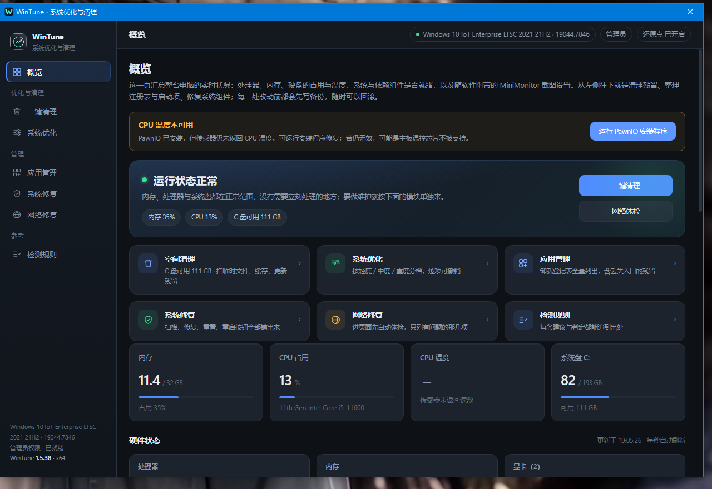
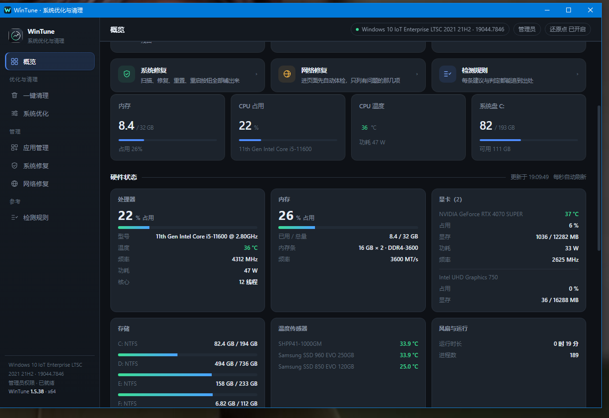

# WinTune / MiniMonitor

**中文** | **[English](#english)**

---

## 中文

WinTune 是一套面向 Windows 10/11 的系统优化、清理与硬件监控工具，由一个桌面主程序和任务栏硬件监控组件组成。

### 项目组成

| 项目 | 版本 | 说明 |
|---|---|---|
| **WinTune** | 1.5.46 | 主程序。WebView2 单文件界面 + C# 引擎，负责扫描、清理、优化、修复、网络诊断和硬件概览。 |
| **MiniMonitor** | 1.6.14 | 任务栏硬件监控与截图工具。可独立运行，也可从 WinTune 启动；包含管理员温度代理和截图编辑器。 |

### WinTune 功能

- **概览**：CPU、内存、显卡、硬盘、温度传感器、风扇与运行状态集中展示，支持一键清理和网络体检。
- **一键清理**：扫描 C 盘临时文件、系统缓存、更新残留；新增「软件缓存」组，按已装软件列出可重建的 Cache / Code Cache / GPUCache / 日志等目录，不碰账号、聊天记录、下载与文档。
- **系统优化**：按轻度、中度、重度档位管理系统优化项，支持逐项应用、撤销和原值备份。
- **应用卸载**：只走 BCU 4.16：单个和批量都生成 `.bcul` 交给 `BCU-console`，不启用残留清理。所有软件（含系统组件）只要 BCU 能接手就显示卸载按钮，状态分为「可以卸载 / 谨慎卸载 / 不可卸载」。
- **系统修复**：提供扫描、修复、重置、重启等维护动作，并记录每一步的状态和结果。
- **网络修复**：覆盖 DNS、网卡、网关、hosts、代理、服务、MTU、静态路由和测速。
- **检测规则**：把清理建议、残留判定和维护项的来源、依据集中展示，便于核对。

### MiniMonitor 功能

- **任务栏硬件条**：显示 CPU 温度/占用、GPU 温度/显存、内存占用、网络上下行速度和日期时间。
- **右键菜单**：开机自启、打开 WinTune、清理内存、截图设置、版本和退出。
- **截图工具**：支持 `Alt+A` 截图、框选、标注、颜色和线条编辑；截图设置与保存目录可调整。
- **温度代理**：管理员权限的静默代理写入 CPU 温度共享内存；界面关闭不会结束代理，心跳丢失时自动重建界面。
- **PawnIO 提示**：PawnIO 是内核驱动，检测以服务状态为准。WinTune 启动先确保驱动在跑，再拉起 MiniMonitor；缺驱动且有安装包时，概览页显示「获取温度需安装依赖 PawnIO」。MiniMonitor 启动时也会检测，安装包存在则弹出「安装 / 取消」，安装包不存在时只提示一次。

### 界面截图

WinTune 概览页：硬件状态、温度、清理入口，以及 PawnIO / CPU 温度异常提示。

WinTune 硬件状态面板：CPU、内存、显卡、硬盘、温度传感器与运行状态。

MiniMonitor 任务栏硬件条：CPU/GPU 温度、占用、内存和网络速度。

### 目录

- `WinTune/src`：WinTune 的 C# 后端源码
- `WinTune/app/index.html`：WinTune 的单文件前端界面
- `WinTune/assets`：WinTune 图标
- `WinTune/build.ps1`：WinTune 的 csc 构建脚本
- `WinTune/README.txt`：原始功能说明与版本记录
- `WinTune/BCU-README.md`：BCU 4.16 卸载引擎的放置方式与许可证说明
- `MiniMonitor`：MiniMonitor 源码、截图/录屏模块、温度代理、构建脚本与图标

### 构建说明

项目使用 Windows 自带的 `.NET Framework` `csc.exe` 编译，不依赖 Visual Studio 工程。

- WinTune 运行依赖 WebView2、LibreHardwareMonitor、PawnIO 等 DLL，以及 `runtime` 目录；这些二进制依赖没有放入源码仓库。
- BCU 卸载引擎不提交到源码仓库；发布完整包时把 `BCUninstaller_4.16_portable.zip` 解压到程序根目录的 `BCU` 文件夹。放置方式见 `WinTune/BCU-README.md`。
- MiniMonitor 编译需要 `LibreHardwareMonitorLib.dll`、`System.Buffers.dll`、`System.Memory.dll`、`System.Runtime.CompilerServices.Unsafe.dll` 等同目录依赖。
- 构建脚本保留了作者本地环境的依赖路径，使用前请按自己的目录调整。
- 发布的完整运行包不包含在本仓库中，可在 Releases 或本地发布包中获取。

### 说明

本仓库只整理源码与构建所需文本文件，不包含旧版本完整包、ZIP、EXE、DLL、测试截图、日志、临时文件、PawnIO 安装程序或本地配置备份。

源码主要用于学习、维护和备份。使用清理、注册表、计划任务、驱动安装等功能前，请先理解风险并做好备份。

---

## English

WinTune is a Windows 10/11 system optimization, cleanup, and hardware monitoring suite, consisting of a desktop application and a taskbar hardware monitor.

### Projects

| Project | Version | Description |
|---|---|---|
| **WinTune** | 1.5.46 | Main application. A WebView2 single-page UI plus a C# engine for scanning, cleanup, optimization, repair, network diagnostics, and hardware overview. |
| **MiniMonitor** | 1.6.14 | Taskbar hardware monitor and screenshot tool. Runs independently or from WinTune; includes an elevated temperature agent and screenshot editor. |

### WinTune features

- **Overview**: CPU, memory, GPU, storage, temperature sensors, fan and runtime status, with one-click cleanup and network check.
- **One-click cleanup**: Scans temporary files, system caches and update residue on the C: drive. A separate "software cache" group lists rebuildable Cache / Code Cache / GPUCache / log folders per installed app, without touching accounts, chat history, downloads or documents.
- **System optimization**: Manages optimization items by light/medium/heavy profiles, with per-item apply, revert and original-value backup.
- **Application uninstall**: BCU 4.16 only. Single and batch uninstall both generate a `.bcul` list for `BCU-console`, with no leftover cleanup. Every app, including system components, gets an uninstall button when BCU can handle it; status is shown as "Can uninstall / Uninstall with caution / Cannot uninstall".
- **System repair**: Provides scan, repair, reset and restart maintenance actions, with per-step status and results.
- **Network repair**: Covers DNS, network adapters, gateway, hosts, proxy, services, MTU, static routes and speed tests.
- **Detection rules**: Shows the evidence and source for cleanup suggestions, residue decisions and maintenance items.

### MiniMonitor features

- **Taskbar hardware bar**: CPU temperature/usage, GPU temperature/VRAM, memory usage, network throughput, date and time.
- **Context menu**: Start with Windows, open WinTune, clean memory, screenshot settings, version and exit.
- **Screenshot tool**: `Alt+A` capture, region selection, annotations, colors and line editing; configurable save folder.
- **Temperature agent**: A silent elevated agent publishes CPU temperature to shared memory; closing the UI does not terminate it, and the UI is recreated if its heartbeat is lost.
- **PawnIO prompt**: PawnIO is a kernel driver, so detection follows its service state. WinTune starts the driver first, then launches MiniMonitor. If the driver is missing and an installer exists, the overview page shows “获取温度需安装依赖 PawnIO”. MiniMonitor checks again at startup: with an installer it shows Install / Cancel; without one it prompts only once.

### Screenshots

WinTune overview: hardware status, temperature, cleanup entries, and the PawnIO / CPU temperature warning.

WinTune hardware panel: CPU, memory, GPU, storage, temperature sensors and runtime status.

MiniMonitor taskbar bar: CPU/GPU temperatures, usage, memory and network throughput.

### Layout

- `WinTune/src`: WinTune C# backend source
- `WinTune/app/index.html`: WinTune single-file frontend
- `WinTune/assets`: WinTune icons
- `WinTune/build.ps1`: WinTune csc build script
- `WinTune/README.txt`: Original feature notes and changelog
- `MiniMonitor`: MiniMonitor source, screenshot/recording modules, temperature agent, build script and icons

### Build notes

The project is compiled with the Windows built-in `.NET Framework` `csc.exe`; no Visual Studio project is required.

- WinTune runtime needs WebView2, LibreHardwareMonitor, PawnIO and other DLLs plus a `runtime` directory. These binary dependencies are not included in the source repository.
- The BCU engine is not committed to the source repository. For a full release, extract `BCUninstaller_4.16_portable.zip` into a `BCU` folder next to the program. See `WinTune/BCU-README.md`.
- MiniMonitor compilation needs `LibreHardwareMonitorLib.dll`, `System.Buffers.dll`, `System.Memory.dll`, `System.Runtime.CompilerServices.Unsafe.dll` and other files in the same directory.
- The build scripts retain the author's local dependency paths; adjust them for your own directory before building.
- The complete runnable package is not included in this repository; use Releases or a local package.

### Notes

This repository contains source code and build-related text files only. It does not include old release packages, ZIP/EXE/DLL files, test screenshots, logs, temporary files, the PawnIO installer, or local configuration backups.

Use the cleanup, registry, scheduled-task and driver-install features at your own risk, and make backups before making changes.
